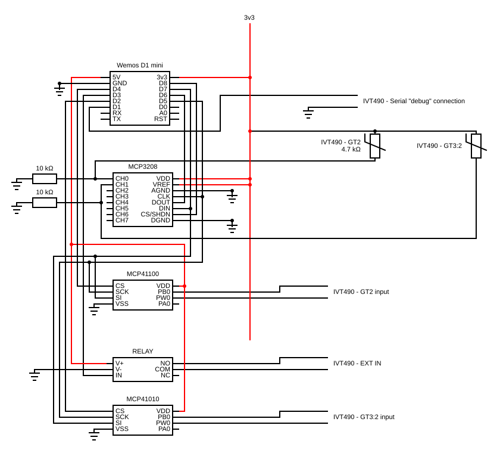

# IVT490-interface-esp8266
Interfacing software/hardware for the IVT490 heatpump tailored for a esp8266 device such as the Wemos D1 mini.

The code serves as a "dumb" API over MQTT.

## Overview
In essence, a combination of software and hardware is used to:

* Read serial output from the heatpump
* Directly read a subset of the NTC resistive sensors used by the IVT490 using ADCs
* Emulate resistive sensors using digitally controlled potentiometers (DCPs)
* Control the EXT_IN port on the heatpump to activate/deactivate the vacation mode

As such, it is possible to emulate input to the IVT490 controller board. The default behavior is however to emulate the same temperature as is being sensed by the resistive sensors, which essentially means to keep the heatpump working as per its own configuration.

Currently, the software and hardware supports to emulate the following temperature sensors:

* GT2 (outdoor temperature sensor)

  This allows for controlling the target feed temperature (GT1_target) of the heating system through knowledge of the heating curve used by the heatpump.

* GT3:2 (boiler temperature)

  This allows for explicitly controlling when the compressor will be active, either by conducting Business as usual, blocking operation or boosting operation.


## Hardware

BOM:

- Wemos D1 mini (Other esp8266-based boards should probably be fine but will obviously require adjustments to the wiring)
- MCP3208 (or a similar one with fewer channels, all wiring schematics are shown using this particular one and may have to be adjusted if exchanged)
- MCP41100
- MCP41010
- 10kOhm resistors (2 pcs)
- 3v3 relay

Schematic:


Both sensors are wired the same way. The real sensor sits between 3v3 and an MCP3208 channel, with a 10 kOhm resistor to ground (`IVT490_ADC_CH{0,1}_R0`): GT2 on CH0, GT3:2 on CH1. A digipot in rheostat mode (PB0-PW0) replaces it towards the heat pump: the MCP41100 for GT2 on CS D4, the MCP41010 for GT3:2 on CS D2. Both digipots and the ADC share the SPI bus (SCK D5, SI/DIN D7, DOUT D6); the ADC's CS is D8, the serial line from the heat pump comes in on D1 and the relay is on D3.

Note: The MCP41100 Vdd pin is connected to 5V in order to allow the 5V connection from the IVT490 ADC. According to the [datasheet](https://ww1.microchip.com/downloads/aemDocuments/documents/OTH/ProductDocuments/DataSheets/11195c.pdf) this should render the 3.3V logic level of the Wemos D1 mini useless but nonetheless, it works... The schematic draws the MCP41010 the same way.

## Software

All pre-deployment configuration of the software in this repository is done using a specific `config.h` include file, see [here](include/README.md) for more details.

## Heatpump (IVT490)

1. Connect to the debug interface on the control board on the heatpump and enable debug output in the heatpump menu. Detailed instructions are available in [this](http://www.tsoft.se/wp/2015/03/08/overvakning-av-min-ivt-490-varmepump-med-raspberry-pi/) blog post.


2. Intersect the GT2 sensor cabling and connect the [Hardware](#hardware) as a "man-in-the-middle".

3. Intersect the GT3:2 sensor cabling and connect the [Hardware](#hardware) as a "man-in-the-middle".

4. Connect the 3v3 relay to the `EXT_IN` port on the heatpump control board.

## API

All communication during runtime happens via MQTT. Every topic below starts with `{MQTT_BASE_TOPIC}`, and nothing is published retained.

### Published

* `{MQTT_BASE_TOPIC}/ivt490/raw`

  The raw text line received on the serial debug connection from the IVT490, published as it arrives (the heat pump sends one about every 60 seconds).

* `{MQTT_BASE_TOPIC}/ivt490/state`

  A JSON blob with the full state of the IVT490, every `GENERAL_STATE_PUBLISH_INTERVAL`. Publishing starts once the first serial line has been parsed. The blob has three objects:

  * `serial`: the values parsed from the serial line: `GT1`, `GT1_target`, `GT1_LLT`, `GT1_LL`, `GT1_UL`, `GT2`, `GT3_1`, `GT3_2`, `GT3_2_LL`, `GT3_2_UL`, `GT3_2_ULT`, `GT3_3`, `GT3_3_target`, `GT3_3_LL`, `GT3_4`, `GT5`, `GT6` (°C), `electricity_supplement`, `GP1`, `GP2`, `GP3`, `compressor`, `vacation`, `P1`, `alarm`, `fan`, `SV1_open`, `SV1_close`. Note that the serial `GT2` and `GT3_2` are the values *as seen by the heat pump*, i.e. after any emulation by this interface.
  * `GT2`: `raw` and `filtered` (10-minute mean) of the real outdoor sensor, as read by the ADC.
  * `GT3_2`: `raw` and `filtered` (10-minute mean) of the real boiler sensor, as read by the ADC.

* `{MQTT_BASE_TOPIC}/controller/state`

  A JSON blob with the state of the software controller, published right after `ivt490/state`: `feed_temperature_target`, `indoor_temperature_feedback` and `outdoor_temperature_offset` (each as `value` and `valid`), `indoor_temperature_target` (`value`) and `operating_mode`.

* Every member of both blobs is also published on its own topic, following the nesting, e.g. `{MQTT_BASE_TOPIC}/ivt490/state/serial/GT1`, `{MQTT_BASE_TOPIC}/ivt490/state/GT2/filtered` or `{MQTT_BASE_TOPIC}/controller/state/outdoor_temperature_offset/valid`. Each nested object also gets a blob of its own (e.g. `{MQTT_BASE_TOPIC}/ivt490/state/serial`).

* `{MQTT_BASE_TOPIC}/diagnostics/{name}`

  Board health, every `DIAGNOSTICS_PUBLISH_INTERVAL` (60 s by default), as plain numbers unless noted:

  | Name | What |
  |---|---|
  | `free_heap`, `max_free_block`, `heap_fragmentation` | Heap state, bytes and percent |
  | `uptime_s` | Seconds since boot |
  | `mqtt_connects` | MQTT connections made since boot |
  | `publish_failures` | Publishes the client refused; each one drops the connection to resync |
  | `oversize_skips` | Publishes skipped because they would not fit `MQTT_BUFFER_SIZE` or the state document |
  | `serial_overflows` | Serial lines longer than the line buffer, dropped |
  | `state_doc_peak` | Most bytes the state document has used |
  | `wifi_rssi` | dBm |
  | `reset_reason` | Text, as reported by the ESP8266 |

### Commands

The controller subscribes to the following, each taking a plain number as its payload. **A payload that parses as 0 is rejected**, so none of these can be set to exactly 0.

* `{MQTT_BASE_TOPIC}/controller/set/feed_temperature_target`

  Target feed temperature (°C). While valid, it takes precedence: the emulated outdoor temperature (GT2) is computed from it through the inverse of the heating curve (`IVT490_HEATING_CURVE_SLOPE`), and the offset and indoor feedback below are not applied.

* `{MQTT_BASE_TOPIC}/controller/set/outdoor_temperature_offset`

  An offset (°C) added to the real outdoor temperature before it is emulated towards the heat pump.

* `{MQTT_BASE_TOPIC}/controller/set/indoor_temperature_actual`

  Indoor temperature feedback (°C). While valid, `IVT490_INDOOR_TEMPERATURE_FEEDBACK_CONTROL_WEIGHT × (actual − target)` is added to the emulated outdoor temperature, so a warm house lowers the feed temperature and a cold one raises it.

* `{MQTT_BASE_TOPIC}/controller/set/indoor_temperature_target`

  Target indoor temperature (°C) for the feedback above. 20.0 until set.

* `{MQTT_BASE_TOPIC}/controller/set/operating_mode`

  Operating mode for the GT3:2 (boiler) emulation:

  * 1, Business as usual: the real boiler temperature is passed through.
  * 2, Block: the heat pump is shown a boiler temperature 1 °C above its upper limit (`GT3_2_UL`), so it does not start heating the boiler.
  * 3, Boost: while the real boiler temperature is below `GT3_2_UL`, the heat pump is shown 1 °C below its lower limit (`GT3_2_LL`), so it starts heating the boiler. At or above the upper limit the real temperature is passed through.

  1 until set.

#### Validity

`feed_temperature_target`, `outdoor_temperature_offset` and `indoor_temperature_actual` are valid for `GENERAL_CONTROL_VALUES_VALIDITY` after they were last received, and the controller falls back to the real sensor values once they expire. To keep one in force, publish it repeatedly, even if it does not change.

`indoor_temperature_target` and `operating_mode` do **not** expire: they hold until a new value arrives or the board restarts, which it does at least daily (`DAILY_RESTART_INTERVAL`) and after `CONNECTIVITY_WATCHDOG_TIMEOUT` without Wi-Fi or MQTT. Both return to their defaults on restart.

#### Summer limit and vacation mode

If `IVT490_SUMMER_TEMPERATURE_LIMIT` is set (> 0), the real outdoor temperature is below 1 °C, and the emulated outdoor temperature would come within 1 °C of the summer limit, the emulated value is held at 1 °C below the limit and `EXT_IN` (vacation mode) is switched on instead. That lowers the feed temperature without letting the heat pump enter summer mode and stop the circulation pump (P1) in freezing weather.

## Build and deploy

Clone (or fork and clone) this repository.

Assemble the hardware according to the [Hardware](#hardware) section and configure the software according to the [Software](#software) section. Then build the software using PlatformIO and upload to your board.


### Updating over the network

The first upload goes over USB. After that the board takes new firmware over WiFi, both ways guarded by `OTA_PASSWORD` (required in `config.h`):

- **HTTP**, started by the uploading host, so it works wherever the board's port 80 is reachable:

  ```bash
  pio run
  curl -u "admin:$OTA_PASSWORD" -F "firmware=@.pio/build/d1_mini_lite/firmware.bin" http://<board-ip>/update
  ```

  The board answers `Update Success! Rebooting...` and restarts on the new image. A failed upload leaves the running firmware in place.

- **ArduinoOTA**, via the `d1_mini_lite_ota` environment (`pio run -e d1_mini_lite_ota -t upload --upload-port <board-ip>`). Here the board connects back to the uploading host, so it fails when a firewall sits between the two.
